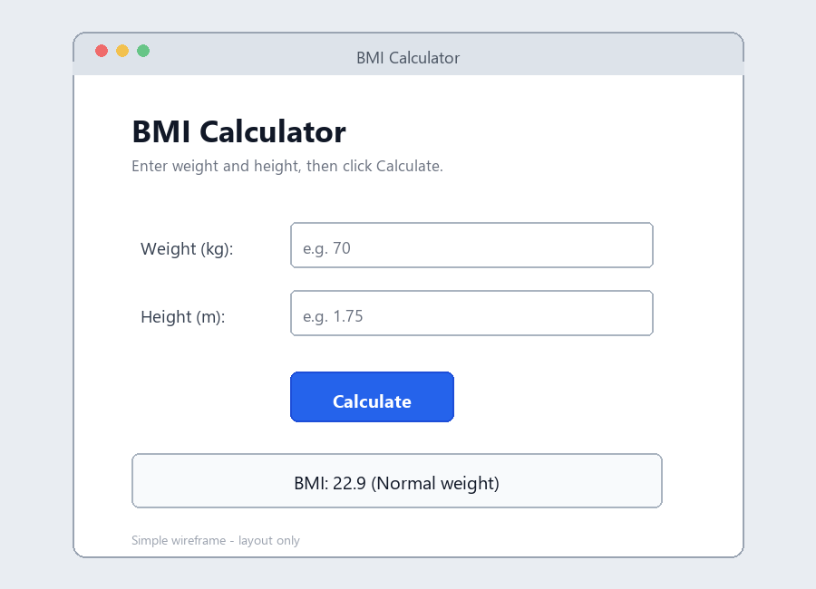
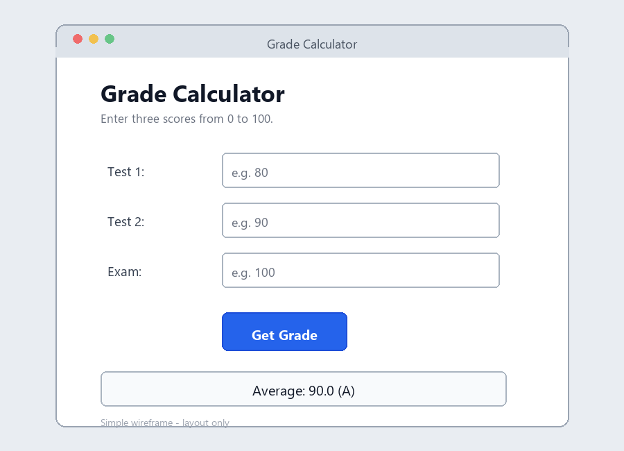

# Week 5 Event-Driven Programming

Two simple Tkinter calculator apps for the Week 5 practical task.

**GitHub repository:** https://github.com/youjun2007/week5-event-driven-apps

## Files

- `bmi_calculator.py` - calculates BMI and shows the category.
- `grade_calculator.py` - averages three scores and shows a letter grade.
- `wireframes/` - simple layout sketches for both screens.

## How to run

Open a terminal in this folder and run one of these commands:

```bash
python bmi_calculator.py
```

```bash
python grade_calculator.py
```

Tkinter is included with the standard Python installation, so no extra packages are needed.

## Wireframes

### BMI Calculator



### Grade Calculator



The original PNG files are in the `wireframes` folder. They can also be imported into Figma if a Figma link is required for submission.

## Input checking

Both apps show a friendly message for blank input, non-numeric input, and values outside the allowed range instead of crashing.

## Submission checklist

- [x] `bmi_calculator.py` runs and calculates correctly
- [x] `grade_calculator.py` runs and calculates correctly
- [x] Buttons are connected to their event handler functions
- [x] Invalid input is caught with `try/except`
- [x] Wireframes are included in this README
- [x] Git repository contains at least three commits
- [x] Code pushed to GitHub
- [x] Repository link included in this README

